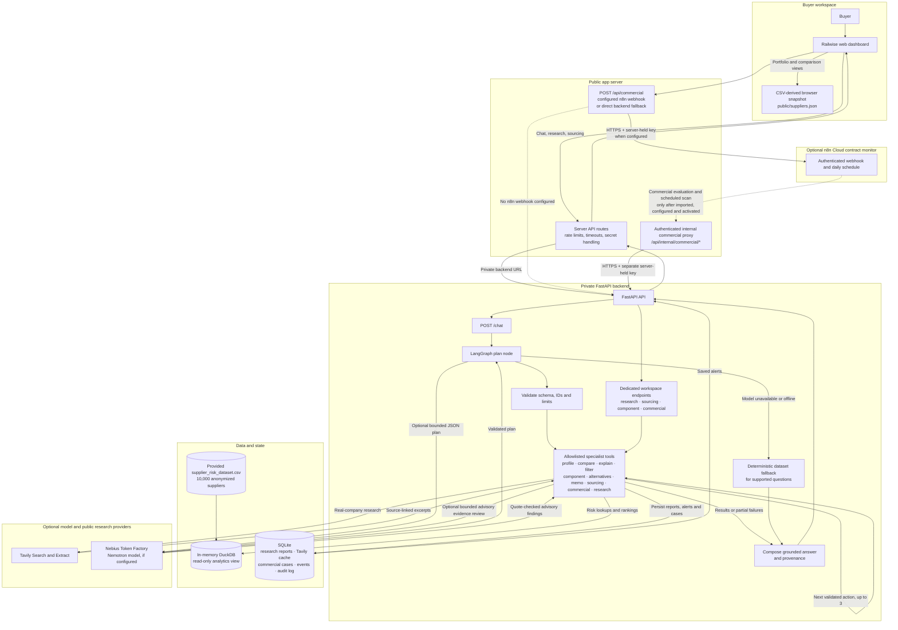

# Railwise — Supplier Risk Intelligence for Rail Procurement

Railwise helps a rail procurement team move from a supplier-risk question to a reviewable sourcing decision. Buyers can explore the supplied 10,000-supplier dataset, ask questions in plain language, screen a component shortlist, compare suppliers, record requirement evidence, and prepare a quote-and-contract negotiation review.

**Temporary demo URL:** [https://81.85.1.219.nip.io/](https://81.85.1.219.nip.io/) — DNS did not resolve when checked on 18 Oct 2026; verify or restore the host before presenting.

**Track:** Siemens Supplier Risk Intelligence · **Repository:** [Ganeshlakshmana/Nebius-hack](https://github.com/Ganeshlakshmana/Nebius-hack)

## Demo walkthrough

1. **Portfolio → Suppliers:** show the risk distribution, search/filter suppliers, and open one risk profile. The profile comes from the supplied CSV snapshot.
2. **Compare:** select three suppliers and compare risk dimensions side by side. Ask the assistant: `Which of SUPP_00012, SUPP_00450 and SUPP_00731 has the lowest financial risk?` It routes the question to a deterministic dataset comparison and returns the values with provenance.
3. **Component → Sourcing:** ask for a component screen, then show the mandatory evidence gates. Missing or failed qualification evidence prevents a supplier from becoming ready for authorized review, regardless of its risk rank.
4. **Commercial:** load the clearly marked synthetic quotes, set contract status and buyer constraints, and run the purchasing-set comparison. Show excluded candidates, modeled allocations, contract alerts, and negotiation questions. The result is preparation for a buyer, not a negotiated price or award.
5. **Research (if time):** research a real company, inspect the linked source evidence and model-review status, and explain why results remain partial until a person verifies them.

For a narrated script and presentation notes, see [docs/demo-script.md](docs/demo-script.md).

## How one request flows through Railwise

The chart shows the app request path and the optional n8n path. **Not every request runs every agent.** A chat turn enters the LangGraph supervisor, which may use the configured Nebius model to propose a bounded plan, validates that plan, and calls only relevant allowlisted tools. If the model is offline or unavailable, the deterministic data-answer path is used where supported. Dedicated workspaces call their domain endpoint through the same API. Supplier arithmetic stays deterministic; the model plans chat actions and can provide bounded, quote-checked research review when configured.



### Explaining the assistant in a demo

For the question *“Which supplier has the lowest financial risk?”*, the path is:

`Dashboard chat → /api/chat → FastAPI /chat → LangGraph plan and validation → compare tool → DuckDB supplier snapshot → grounded answer and comparison table → dashboard`

The supervisor is a bounded orchestrator, not a group of agents debating autonomously. With a model configured, it proposes up to three allowlisted actions; the application validates supplier IDs and the full plan before execution. A deterministic fallback handles supported dataset questions when the model is unavailable, and partial failures are reported instead of claiming a tool succeeded. In the chat UI, internal graph execution details are hidden from the buyer.

For *“Research Knorr-Bremse”*, the research service asks Tavily for public sources, extracts selected pages, checks company/domain context and incident-vs-policy signals, then may ask Nemotron on Nebius Token Factory for a constrained, quote-backed review. Sources and excerpts are retained with the report. Model findings are advisory and unverified; research does not alter the CSV risk scores.

## What the system does

- **Supplier portfolio:** search, filter, rank and compare up to 20 anonymized suppliers across supplied risk dimensions and operating metrics.
- **Conversational assistant:** routes dataset questions to profile, comparison, explanation, ranking, component, sourcing, research, memo or commercial tools.
- **Component screening:** applies transparent component risk factors to supplier records. The challenge data has no bill-of-materials mapping, so component assignments and component scores are **simulated screening overlays**, not evidence that a supplier makes or is qualified for a part.
- **Sourcing workspace:** scores the buyer's shortlist against buyer-authored requirements and evidence. Missing mandatory evidence remains open; a failed mandatory requirement blocks review readiness.
- **Commercial workspace:** checks entered quotes and contract assumptions for comparability, validity, delivery lead time, capacity, minimum order, risk ceiling and supplier concentration. It enumerates feasible allocations and drafts negotiation questions.
- **Company research:** gathers public evidence with source links and labels identity, extraction and interpretation limits. No anonymous `SUPP_...` ID is assumed to identify a real company.
- **Decision artifacts:** export a shortlist summary and review packets for human use.

## Data integrity and decision boundaries

| Information | Source and status |
|---|---|
| Supplier IDs, names, risk factors, Total Risk Index, delivery and purchasing metrics | Supplied `supplier_risk_dataset.csv`; original values are retained. |
| Total Risk Index explanation | The source does not include its formula or weights. Driver contributions are estimates, not the original formula. |
| Component assignment and component risk | Deterministic **synthetic overlay** because the CSV has no component/BOM relationships. |
| Qualification evidence and contract facts | Buyer-entered records; authenticity, legal interpretation and applicability are not independently verified. |
| Commercial quotes and operation feed | Synthetic demo inputs unless replaced with reviewed buyer data. |
| Company research | Public web sources retrieved on demand; identity and claims require human verification. No results do not mean low risk. |

Risk values use 0 = lower risk and 100 = higher risk; delivery/confirmation rates retain their performance meaning. The dataset has no snapshot date. Railwise does not certify compliance, infer engineering capability, send supplier communications, commit purchase orders, or automatically award contracts.

Challenge input files: [`data/supplier_risk_dataset.csv`](data/supplier_risk_dataset.csv) and [`data/risk_criteria_description.md`](data/risk_criteria_description.md).

## Stack and backend endpoints

- **Frontend:** React, TypeScript, shadcn/ui, Vinext/Vite.
- **API:** FastAPI; **chat orchestration:** LangGraph StateGraph; **model:** configured through an OpenAI-compatible endpoint (Nebius Token Factory/Nemotron in the demo configuration).
- **Supplier analytics:** in-memory DuckDB reads the supplied CSV through a read-only analytics view.
- **Application state:** SQLite stores reports, search cache, operation events, commercial cases and audit events.
- **Research:** Tavily Search and Extract, with bounded result counts and cached search results.
- **Hosting:** Nebius CPU VM, Docker Compose, Caddy HTTPS reverse proxy. The backend stays on the private Docker network.

Useful backend endpoints:

| Endpoint | Purpose |
|---|---|
| `GET /suppliers` and `GET /suppliers/{id}` | Filtered portfolio and supplier profiles |
| `POST /compare` and `GET /suppliers/{id}/explain` | Risk comparison and score explanation |
| `POST /chat` | LangGraph-supervised assistant |
| `POST /components/analyze` | Component-specific screening |
| `POST /sourcing/evaluate` | Requirement and evidence gate evaluation |
| `POST /commercial/evaluate` | Quote, contract-assumption and allocation analysis |
| `POST /research` and `GET /research/{id}` | Start and retrieve a company research report |
| `POST /commercial/scan` and `GET /commercial/alerts` | Refresh and read saved commercial alerts |

## Run locally

Requires Node.js 22.13+, npm, and Python 3.11+.

```sh
# Terminal 1 — install and start the backend from the repository root
python -m pip install -e backend
cp .env.example .env
python -m uvicorn app.main:app --app-dir backend --host 127.0.0.1 --port 8000

# Terminal 2 — start the web app from the repository root
npm run install:ci
npm run dev
```

Open [http://127.0.0.1:5173](http://127.0.0.1:5173). The backend health endpoint is [http://127.0.0.1:8000/health](http://127.0.0.1:8000/health); API documentation is at [http://127.0.0.1:8000/docs](http://127.0.0.1:8000/docs).

For live company research and model-assisted planning, set `OFFLINE_MODE=false`, `TAVILY_API_KEY`, `LLM_API_KEY`, `LLM_BASE_URL`, and `LLM_MODEL` in the private `.env`. Demo browsing and deterministic risk calculations do not require provider calls. Never commit `.env` or paste provider keys into a workflow export.

## n8n negotiation-preparation workflow

The repository includes an authenticated app-to-n8n bridge and importable workflow templates in [`integrations/n8n/`](integrations/n8n/). **The templates are not yet imported or activated in n8n Cloud.** Once connected, n8n will orchestrate commercial evaluation and a scheduled alert refresh; it will not negotiate with suppliers or send messages. See [`integrations/n8n/README.md`](integrations/n8n/README.md) for setup, credential separation, and test order.

## Tests and references

```sh
cd backend
python -m pip install -e '.[test]'
python -m pytest -q
```

See [challenge readiness and gaps](docs/challenge-readiness.md), [data and assistant audit](docs/DATA-AND-ASSISTANT-AUDIT.md), [LangGraph supervisor controls](docs/LANGGRAPH-SUPERVISOR.md), and [the demo script](docs/demo-script.md).
