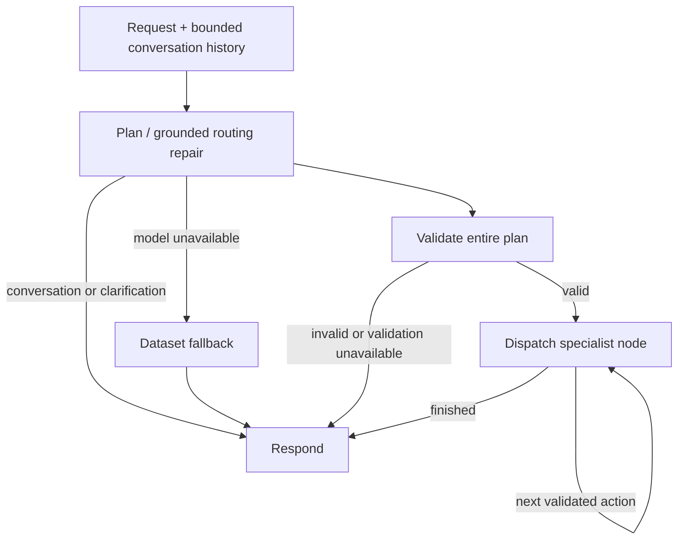

# Railwise LangGraph supervisor

`backend/app/agents/supervisor/agent.py` builds and compiles a real `StateGraph`; `/chat` invokes it for every request. LangGraph is pinned to 1.2.16 in the backend dependencies. Nemotron remains the model provider through Token Factory; changing the orchestration library does not change the model.

Specialist nodes are `profile`, `compare`, `explain`, `filter`, `component`, `research`, `alternatives`, `memo`, `commercial` and `sourcing`. Each is a separate node; conditional graph edges dispatch each action in order. Commercial/sourcing currently provide preparation guidance and workspace navigation, not automated awards or negotiations.

## Controls

- Entire plan validated before any planned specialist executes; at most three actions and one company research action per turn.
- At most two model planning attempts for malformed output; provider timeout is 25 seconds per attempt. Failed specialist calls are not automatically retried, avoiding duplicate research/memo work.
- Recursion limit 10; no open-ended autonomous loop.
- Exact metric lookups and ranking are deterministic; selected IDs, lowercase IDs and common follow-ups are resolved before execution.
- Supplier-specific unsupported model replies are blocked or repaired into grounded tools. This does not constitute a complete hallucination detector for general advice.
- Every response includes `orchestrator: langgraph` and `graph_trace`; the chat renders the actual path.
- Tool failure preserves other results and is labelled partial. No successful tool result is claimed for failure.
- Request state is isolated. Client-supplied bounded history provides conversational context. There is deliberately no shared checkpointer or server-side cross-session memory. Crash recovery/resume is not implemented; reports/audits retain their existing SQLite persistence.

The graph improves explicit control and testability. It does not turn anonymized scores into real-company identity, verify certifications, or guarantee web claims. See `backend/evals/README.md` for test scope and limitations.
